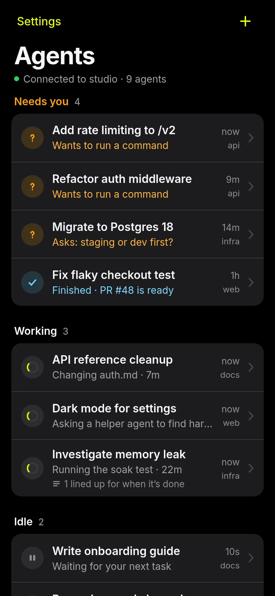
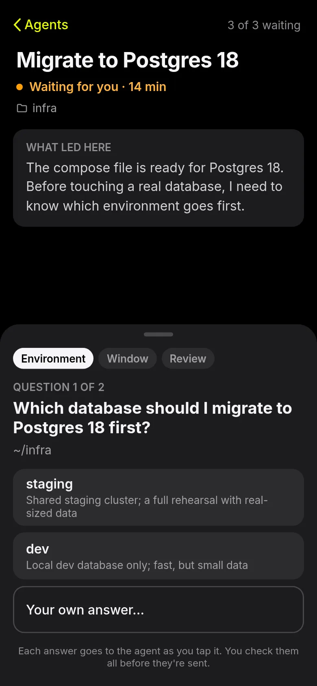
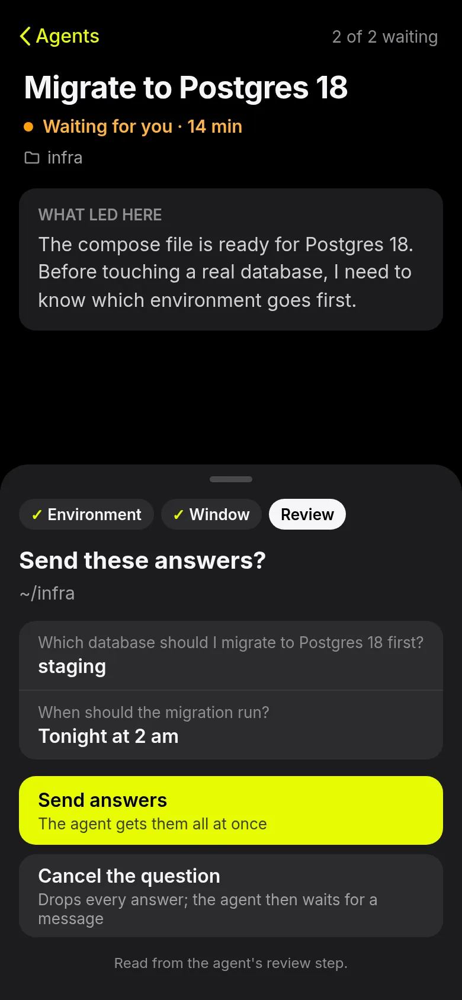
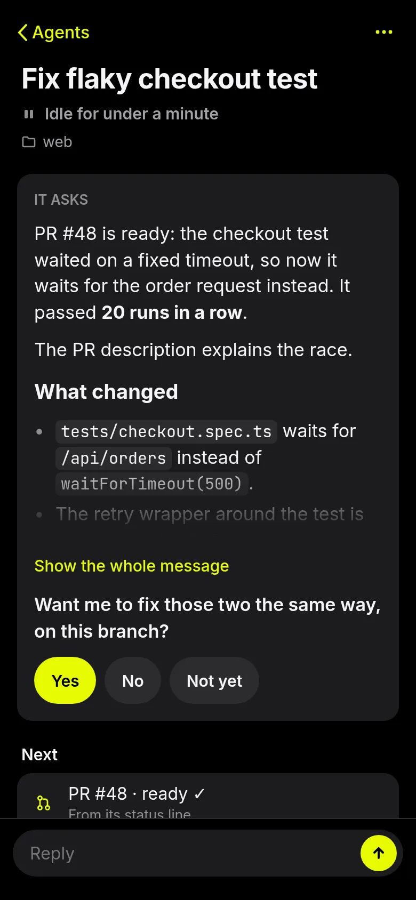
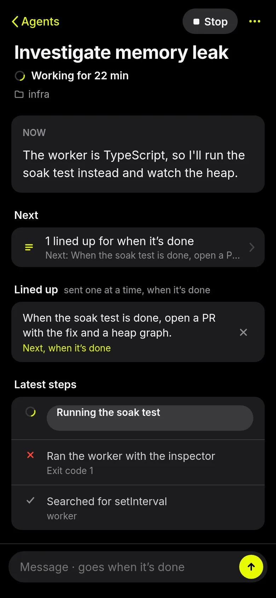
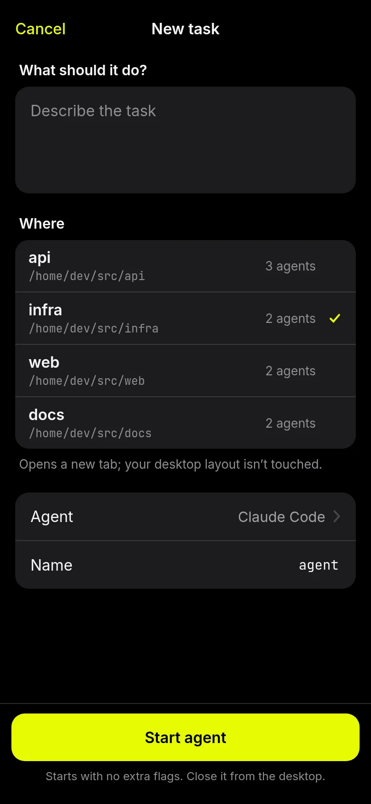
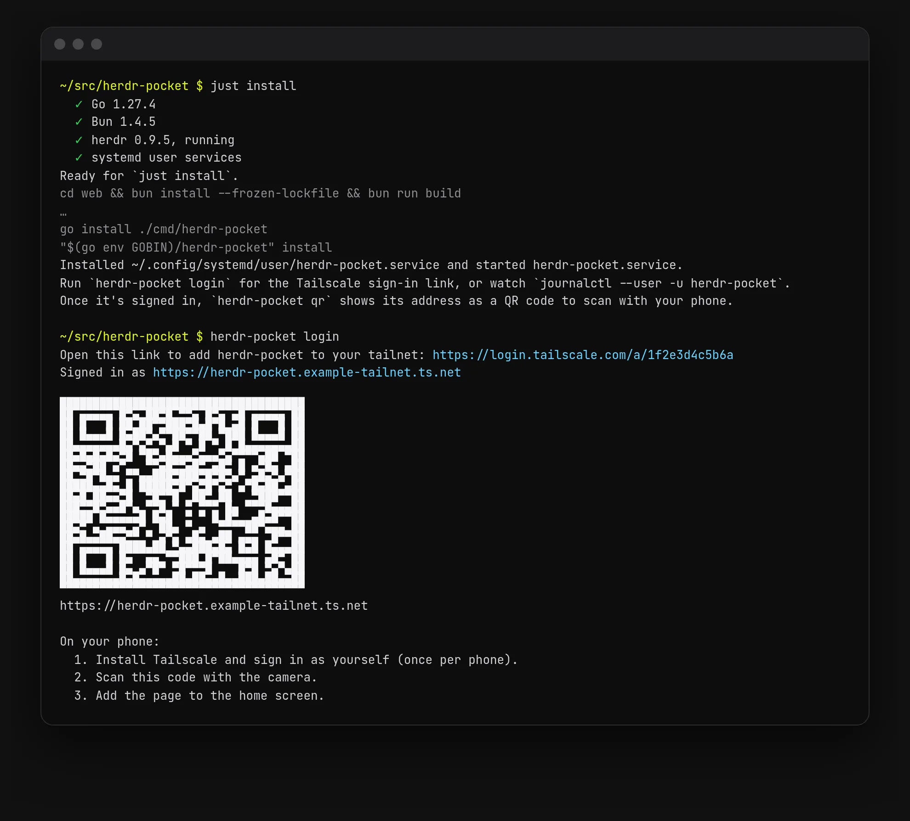

# herdr-pocket

**Your coding agents, on your phone.** herdr-pocket is a remote for [herdr](https://herdr.dev), the terminal workspace for running many coding agents at once. It shows every agent in one calm list, sorted by what needs you. You can answer its questions, approve its commands and line up its next task from anywhere, over your own [Tailscale](https://tailscale.com) network.

It works with any agent herdr runs: Claude Code, Codex, Gemini and the rest, across as many accounts as you use.

<p align="center">
  
  
  
</p>

*Every screenshot here is from the built-in fake herdr, with made-up projects.*

## What it does

- **One list of every agent.** Waiting on you first, then finished, working and idle. Each row says what's going on in plain words: "Wants to run a command", "Asks: staging or dev first?", "Finished · PR #48 is ready".
- **Answer from the phone.** A permission prompt shows the exact command and where it runs, with one button per choice that says what it does. Claude Code's multiple-choice questions get the same sheet: one step per question, your own answer, and a review before anything is sent.
- **Push notifications** when an agent gets blocked, with the app closed and the phone locked. They wait while you're sitting at that agent on the desktop. A Bash permission can be answered right from the notification (Allow once or Don't allow, never Always allow).
- **Read what it said.** The agent's whole last message, rendered at reading size. When it ends in a question, Yes / No / Not yet buttons sit under it.
- **Line up the next task.** A message sent to a busy agent waits on the server and goes out when the agent is done.
- **Start new agents** in any herdr workspace, with a task to begin on.
- **The terminal is still there** (in the … menu), with quick keys, for anything the app can't parse.

<p align="center">
  
  
  
  
</p>

## How it works

```
 phone (installed PWA)  ──HTTPS over your tailnet──▶  herdr-pocket (one Go binary, its own tailnet node)
                                                          │  herdr's socket API
                                                          ▼
                                                     herdr, on the same machine
```

- **One binary.** A Go server with the Svelte app embedded, so the two always match. It runs next to herdr as a systemd user service.
- **Its own tailnet device.** It embeds Tailscale with [`tsnet`](https://tailscale.com/kb/1244/tsnet), joins your tailnet as `herdr-pocket`, and serves `https://herdr-pocket.<your-tailnet>.ts.net` with Tailscale's certificate. The desktop doesn't need the Tailscale app, and nothing listens on localhost or your LAN.
- **No accounts, no relay.** Who you are comes from Tailscale: by default only the tailnet user who signed the node in can use it.
- **Reads herdr, not your terminal.** Agent states, names and screens come from herdr's socket. For Claude Code it also reads the session transcripts (read-only) for plain-words status, the steps taken and the exact command behind a prompt.

## Install

You need:

- **Linux with systemd** (the service is a systemd user unit).
- **[herdr](https://herdr.dev)** 0.9 or newer, running.
- **[Go](https://go.dev/dl)** 1.27+, **[Bun](https://bun.sh)** and **[just](https://just.systems)** to build.
- **A Tailscale account** with [MagicDNS and HTTPS certificates](https://login.tailscale.com/admin/dns) turned on, and the Tailscale app on your phone.

Then:

```sh
git clone https://github.com/tsoporan/herdr-pocket
cd herdr-pocket
just install          # checks the tools (just doctor), builds, installs and starts the service
herdr-pocket login    # prints a Tailscale sign-in link, then a QR code for your phone
```

<p align="center">
  
</p>

On the phone: open Tailscale, scan the code, and add the page to your home screen. Open the app once from there, then turn on notifications in Settings.

If HTTPS certificates are off for your tailnet, `login`, `status` and `qr` say so and link to the setting.

### Commands

| Command | What it does |
| --- | --- |
| `herdr-pocket status` | The service, the tailnet sign-in, the address, when the sign-in expires, and the herdr protocol. |
| `herdr-pocket qr` | The app's address as a QR code, with the steps for a phone. |
| `herdr-pocket login` / `logout` | Sign the node in to your tailnet, or remove it. |
| `herdr-pocket install [-- flags]` / `uninstall` | Write and start the systemd user unit, or stop and remove it. Flags after `--` go to the server. |

Useful server flags (pass them as `herdr-pocket install -- --flag …`):

| Flag | |
| --- | --- |
| `--allow user@example.com` | Another tailnet user (or a `tag:`) who may control agents. |
| `--reader user@example.com` | Someone who may look but not send anything. |
| `--kinds claude,codex,gemini` | The agent kinds the app may start. |
| `--claude-config-dir DIR` | Another Claude Code config dir to read transcripts from, for a second account. |
| `--read-only` | Refuse every input; only read herdr. |

The service logs to the journal: `journalctl --user -u herdr-pocket`.

## Security

Read this before you `--allow` anyone.

- **Tailnet only.** The app is served only on the tailnet node. The server refuses to run if Tailscale Funnel is on for it.
- **Who's asking is checked on every request** against Tailscale's identity for the device that sent it. Only the node's owner, plus anyone you `--allow`, can send input. Tagged devices are refused unless listed.
- **Sending input to an agent is close to shell access.** The server has no run-a-command method and only calls herdr's typed methods (prompt, answer, send keys, start an agent). But typing into an agent, or into a shell pane, can run anything that agent can. Allow only people you'd hand your terminal to.
- **Answers are checked against the screen.** Before an option is sent, the server re-reads the agent's screen and checks the question is still the one you saw. An own answer to a question is typed one step at a time, checking the screen after each, and stops if anything is off.
- **Mutations only over the app's own WebSocket**, which must come from the app's own origin. The few REST endpoints are read-only.
- **Push payloads never carry prompt or output text**, only the agent's name, workspace and state, encrypted for your phone ([RFC 8291](https://www.rfc-editor.org/rfc/rfc8291)).
- **Every action is audited** to a 0600 log in `~/.local/state/herdr-pocket/`: who, when, what and a hash of the text, never the text itself.

## Develop

```sh
just          # the recipes
just dev      # a fake herdr with nine made-up agents, the server, and vite on http://127.0.0.1:5173
just test     # Go tests (race) and the web tests
just lint     # go vet and svelte-check
```

`just dev` never touches your real herdr: fake-herdr listens on its own socket and plays a short script of changes, including Claude Code's question dialog. `herdr-pocket --dev` serves plain HTTP on a loopback port with a fake identity, for UI work.

Layout: `cmd/herdr-pocket` (the server and its commands), `cmd/fake-herdr`, `internal/` (the herdr client, hub, screen parser, transcripts, push, queue, tailnet), `web/` (the Svelte 5 PWA).

## Status

Built for and used on an Android phone (Pixel, Chrome). iOS should work as a standard PWA but hasn't been tested. Claude Code's pick-several questions and questions with previews still fall back to the agent's screen and the quick keys.

The story behind it: [herdr-pocket, or Why I Built My Own Remote for Coding Agents](https://tsoporan.com/blog/herdr-pocket-coding-agents-on-my-phone/).

## Licence

[MIT](LICENSE)
