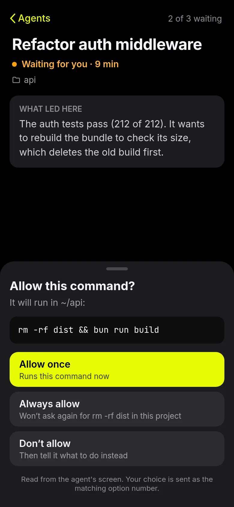

# herdr-pocket

**Every coding agent you run, on your phone, over your own network.**

You run a lot of coding agents in [herdr](https://herdr.dev): Claude Code, Codex, Gemini and others, often across several accounts. When you step away from the desk, any of them that stops to ask you something just waits until you're back.

Vendor remotes don't fix that. Each one shows only its own agents, and often only for one account. herdr-pocket is one remote for all of them:

- **Every agent, every vendor, every account, in one list.** It reads herdr, which already treats every agent the same way, so a Codex agent sits next to a Claude one.
- **On your own network.** It joins your [Tailscale](https://tailscale.com) network as its own device. There's no cloud relay, no account to make, and no open port. Only you can reach it, from your phone.
- **Built for answering, not watching.** You get a push when an agent needs you, tap it, answer, and the agent carries on.

<p align="center">
  
  
  
</p>
<p align="center">
  
  
  
  
</p>

<p align="center"><sub>Screenshots from the built-in fake herdr, with made-up projects.</sub></p>

## Install

**You need** Linux with systemd, [herdr](https://herdr.dev) running, [Go](https://go.dev/dl) 1.27+, [Bun](https://bun.sh) and [just](https://just.systems) on the desktop. You also need a Tailscale account with [HTTPS certificates turned on](https://login.tailscale.com/admin/dns), and the Tailscale app on your phone. The desktop doesn't need Tailscale installed.

**1. Build and start it**

```sh
git clone https://github.com/tsoporan/herdr-pocket && cd herdr-pocket
just install
```

This checks the tools first, then builds and starts herdr-pocket as a systemd user service.

**2. Add it to your tailnet**

```sh
herdr-pocket login
```

Open the link it prints and approve the device. It then prints a QR code.

**3. Open it on your phone**

Scan the QR code with the camera, add the page to your home screen, and open it from there. Turn on notifications in Settings.

<p align="center">
  
</p>

Something off? `herdr-pocket status` shows the service, the sign-in and the address, and `just doctor` re-checks the tools. If HTTPS certificates are off for your tailnet, both `status` and `login` say so.

## What it does

- **One calm list.** Agents waiting on you come first, then finished, working and idle. Each row says what's happening in plain words: "Wants to run a command", "Asks: staging or dev first?", "Finished · PR #48 is ready".
- **Answer permission prompts.** You see the exact command and where it runs, with one button per choice that says what it does.
- **Answer Claude Code's questions.** One step per question, room for your own answer, and a review before anything is sent.
- **Push notifications** when an agent gets blocked, with the app closed and the phone locked. They hold off while you're at that agent on the desktop. A Bash permission can be answered right from the notification (Allow once or Don't allow, never Always allow).
- **Read what it said.** The agent's whole last message, at reading size. When it ends in a question, Yes / No / Not yet buttons sit under it.
- **Line up the next task.** A message to a busy agent waits on the server and goes out when the agent is done.
- **Start new agents** in any herdr workspace, with a task to begin on.
- **The terminal is still there**, with quick keys, for anything the app can't read.

## How it works

```
 phone (installed web app)  ──HTTPS, inside your tailnet──▶  herdr-pocket (one Go binary, its own tailnet device)
                                                                │  herdr's socket API
                                                                ▼
                                                           herdr, on the same machine
```

- **One binary**, a Go server with the Svelte app built in, running next to herdr.
- **Its own tailnet device.** It embeds Tailscale ([`tsnet`](https://tailscale.com/kb/1244/tsnet)) and serves `https://herdr-pocket.<your-tailnet>.ts.net` with Tailscale's certificate. Nothing listens on localhost or your LAN.
- **Identity from Tailscale.** Only the tailnet user who signed the device in can use it, unless you allow others.
- **Reads herdr, not your terminal.** Agent states and screens come from herdr's socket. For Claude Code it also reads the session transcripts (read-only), for plain-words status, the steps taken and the exact command behind a prompt.

## Configure

| Command | |
| --- | --- |
| `herdr-pocket status` | The service, the tailnet sign-in, the address, and when the sign-in expires. |
| `herdr-pocket qr` | The app's address as a QR code, for another phone. |
| `herdr-pocket login` / `logout` | Sign the device in to your tailnet, or remove it. |
| `herdr-pocket install -- <flags>` / `uninstall` | Reinstall the service with server flags, or remove it. |

| Server flag | |
| --- | --- |
| `--allow user@example.com` | Another tailnet user (or a `tag:`) who may control agents. |
| `--reader user@example.com` | Someone who may look but not send anything. |
| `--kinds claude,codex,gemini` | The agent kinds the app may start. |
| `--claude-config-dir DIR` | Another Claude Code config dir to read transcripts from, for a second account. |
| `--read-only` | Refuse every input; only read herdr. |

Logs: `journalctl --user -u herdr-pocket`.

## Security

Read this before you `--allow` anyone.

- **Tailnet only.** The app is served only on its tailnet device, and the server refuses to run if Tailscale Funnel is on for it.
- **Every request is checked** against Tailscale's identity for the device that sent it. Only the owner, plus anyone you `--allow`, can send input. Tagged devices are refused unless listed.
- **Sending input to an agent is close to shell access.** The server has no run-a-command method and only calls herdr's typed methods (prompt, answer, send keys, start an agent). But typing into an agent, or into a shell pane, can run anything it can. Allow only people you'd hand your terminal to.
- **Answers are checked against the screen.** Before it sends an option, the server re-reads the agent's screen and checks the question is still the one you saw. Your own answer to a question is typed one step at a time, with the screen checked after each.
- **Changes go only over the app's own WebSocket**, which must come from the app's own origin. The few plain HTTP endpoints are read-only.
- **Push payloads never carry prompt or output text**, only the agent's name, workspace and state, encrypted for your phone ([RFC 8291](https://www.rfc-editor.org/rfc/rfc8291)).
- **Every action is audited** to a private log in `~/.local/state/herdr-pocket/`: who, when, what and a hash of the text, never the text itself.

## Develop

```sh
just          # the recipes
just dev      # a fake herdr with nine made-up agents, the server, and vite on http://127.0.0.1:5173
just test     # Go tests (race) and the web tests
just lint     # go vet and svelte-check
```

`just dev` never touches your real herdr: fake-herdr listens on its own socket and plays a short script of changes, including Claude Code's question dialog.

## Status

Built for and used on an Android phone (Pixel, Chrome). iOS should work as a standard web app but hasn't been tested. Claude Code's pick-several questions, and its questions with previews, still fall back to the agent's screen and the quick keys.

The story behind it: [herdr-pocket, or Why I Built My Own Remote for Coding Agents](https://tsoporan.com/blog/herdr-pocket-coding-agents-on-my-phone/).

## Licence

[MIT](LICENSE)
